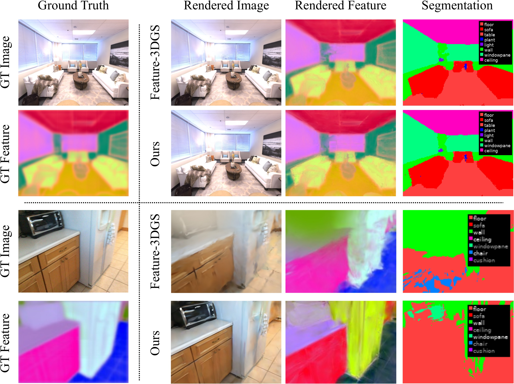

<div align="center">

# MLP Splatting

### Object-Centric Neural Fields

Compact neural primitives for photorealistic rendering, scene decomposition, and feature-aware interaction.

[**Paper**](https://arxiv.org/abs/2606.03877) · [**Project page**](https://www.shinjeongkim.com/mlp-splatting/) · [**Benchmarks**](benchmarks/bigboy_room0/README.md)

[](https://arxiv.org/abs/2606.03877)
[](https://www.shinjeongkim.com/mlp-splatting/)
[](#installation)
[](#installation)


</div>

MLP Splatting represents a scene with a small set of spatially localized neural primitives. Each primitive is a compact MLP mapping viewing direction and the soft-contact residual to color and density; four locally gated feature slots extend the same representation to dense semantic features.

This repository exposes one canonical implementation: the feature-capable tile CUDA renderer. Historical experimental renderers, duplicated scene folders, notebooks, generated binaries, and machine-specific launch code have been removed from the public path.

## Method

- **Object-centric primitives.** Local support makes every neural field spatially interpretable while retaining more capacity than an atomic point primitive.
- **Compact radiance MLPs.** A 6D position-direction input is encoded to 72 dimensions and evaluated by a `72 → 32 → 32 → 4` network.
- **Sparse tile rendering.** Conservative projected-support bounds build each tile's candidate list; shared tile-center ordering, block radix sorting, and early termination keep inference efficient.
- **Feature-aware compositing.** Four tetrahedrally gated feature slots per primitive are blended by the same visibility weights as RGB.
- **Simple training.** An octree initializes primitives from the COLMAP point cloud; the paper configuration uses no densification or pruning.

<p align="center">
  
</p>

## Installation

The custom renderer requires Linux, an NVIDIA GPU, a CUDA toolkit with `nvcc`, and a compiler compatible with the selected PyTorch build.

```bash
git clone https://github.com/kxhit/mlp-splatting.git
cd mlp-splatting

python -m venv .venv
source .venv/bin/activate
python -m pip install --upgrade pip

# Install the appropriate PyTorch CUDA wheel first:
# https://pytorch.org/get-started/locally/
python -m pip install -e .
```

The extension in `mip360/cuda/np_tile_kernels.cu` is compiled lazily on first render and cached by PyTorch. Set `TORCH_EXTENSIONS_DIR` when an explicit cache location is useful.

The editable install also provides `mlpsp-train`, `mlpsp-train-replica`, `mlpsp-eval-rgb`, `mlpsp-eval-lseg`, `mlpsp-benchmark`, and `mlpsp-convert-checkpoint`. The source-tree commands below remain explicit so their implementation is easy to locate.

## Data

Scenes use COLMAP metadata and Mip-NeRF 360-style image folders. Optional feature tensors are matched to images by filename stem and can be stored as `.npy`, `.npz`, or `.pt`.

```text
<scene>/
├── images/                       # full resolution
├── images_{2,4,8}/               # optional downsampled images
├── sparse/0/
│   ├── cameras.bin
│   ├── images.bin
│   └── points3D.bin
├── rgb_feature_langseg/          # optional 512D LSeg features
└── sam_embeddings/               # optional 256D SAM features
```

Use `--factor 1`, `2`, `4`, or `8` to select the corresponding image folder. Evaluation JSON records the exact ordered view manifest so that split mismatches are visible. LSeg tensors must expose a 512-channel axis and SAM tensors a 256-channel axis; ambiguous feature layouts and duplicate normalized stems fail explicitly. The current camera path accepts shared, centered, distortion-free `SIMPLE_PINHOLE` intrinsics or near-square-pixel `PINHOLE` intrinsics; unsupported or inconsistent COLMAP cameras likewise fail instead of producing incorrect rays.

For the `room0` numbers below, use the [Feature-3DGS processed Replica archive](https://drive.google.com/file/d/1sC2ZJUBRHKeWXXVUj7rIBEM-xaibvGw7/view?usp=sharing), whose scene folders already follow this COLMAP layout. The source dataset and download instructions live in the [official Replica repository](https://github.com/facebookresearch/Replica-Dataset); retain its license and citation when redistributing data. The benchmark fixes `replica_feature3dgs`, `test_offset=2`, factor 1, and checks that exactly ten held-out views are present.

## Training

The paper reports a `72 → 32 → 32 → 4` MLP, 512D features, 8×8 tiles, the learning rates below, and 60,000 iterations. The public recipe additionally selects tile-center traversal, four-view tile mosaics, `--min-points 10`, and direct four-slot feature storage.

```bash
python mip360/run.py \
  --data <scene> \
  --output outputs/<scene>-lseg \
  --feature-type lseg \
  --feature-dir <scene>/rgb_feature_langseg
```

For Replica, use the dataset-specific entrypoint with the same arguments:

```bash
python replica/run.py \
  --data <replica-scene> \
  --output outputs/<scene>-lseg \
  --feature-type lseg
```

Useful explicit defaults are:

```text
--iterations 60000       --min-points 10
--tile-order tilecenter  --tile-size 8
--tile-mosaic            --mosaic-views 4
--feature-slots 4        --feature-lowdim-divisor 1
--learning-rate 1e-3     --log-scale-lr 1e-2
```

Use `--feature-type none` for RGB-only training. Position parameters use a learning rate of `1e-4`, matching the paper. Run `python mip360/run.py --help` for the complete interface.

## Evaluation

RGB metrics:

```bash
python mip360/eval_rgb_psnr.py \
  --data_dir <scene> \
  --scene_ckpt <checkpoint.pt> \
  --dataset_loader replica \
  --split_mode replica_feature3dgs \
  --split_test_offset 2 \
  --tile_order tilecenter \
  --tile_size 8 \
  --score_threshold 3e-3 \
  --disable_lpips \
  --save_json metrics.json
```

`mip360/eval_lseg_table2.py` provides the semantic evaluation path used for paper-style LSeg metrics. Semantic labels and text embeddings are dataset-specific and are not bundled. Install the optional dependencies, then provide either precomputed text features or label names for CLIP encoding:

```bash
python -m pip install -e ".[evaluation]"

python mip360/eval_lseg_table2.py \
  --data_dir <scene> \
  --scene_ckpt <checkpoint.pt> \
  --gt_mode semantic_png \
  --gt_semantic_dir <semantic-label-pngs> \
  --labels_file <one-label-per-line.txt> \
  --text_feature_pt <matching-lseg-text-features.pt> \
  --tile_order tilecenter \
  --tile_size 8 \
  --score_threshold 3e-3 \
  --save_json semantic-metrics.json
```

Omit `--text_feature_pt` to encode `--labels_file` with the pinned OpenAI CLIP dependency.

## Inference benchmark harness

The benchmark renders both RGB-only and fused RGB+feature outputs, measures synchronized wall and CUDA-event latency after full-view warm-up cycles, computes PSNR, verifies RGB parity between both kernels, and saves hardware, view, command, Git, source-hash, and checkpoint-hash provenance.

```bash
CUDA_VISIBLE_DEVICES=0 python tools/benchmark_inference.py \
  --data <scene> \
  --checkpoint <feature-checkpoint.pt> \
  --dataset-loader replica \
  --split-mode replica_feature3dgs \
  --split-test-offset 2 \
  --expected-views 10 \
  --tile-order tilecenter \
  --tile-size 8 \
  --score-threshold 3e-3 \
  --warmup-cycles 3 \
  --timed-cycles 3 \
  --output benchmark-gpu0.json
```

Run the same command with `CUDA_VISIBLE_DEVICES=1` in a second shell for the other card.

### Bigboy release selection

We screened the recovered feature renderer and cross-ran the finalists on physical GPU 0 and 1, both **NVIDIA RTX 6000 Ada Generation** cards. The test scene is Replica `room0` at 638×478: ten fixed held-out views, a 60k-step checkpoint with 1,344 primitives and 512D features, three full warm-up cycles, then three timed cycles per GPU and mode. Values below are means across both cards.

| Ordering | Tile | Threshold | PSNR ↑ | RGB-only FPS ↑ | Fused RGB+feature FPS ↑ |
|---|---:|---:|---:|---:|---:|
| per-pixel | 16×16 | `3e-3` | **35.9023** | **61.30** | 11.36 |
| **tile-center** | **8×8** | **`3e-3`** | **35.8490** | 28.38 | **12.45** |
| tile-center, aggressive | 8×8 | `1e-2` | 35.6924 | 32.43 | 14.42 |

The released default is **tile-center / 8×8 / `3e-3`**. For fused feature inference it is 9.6% faster than the cross-GPU per-pixel finalist while losing only 0.053 dB PSNR. The `1e-2` preset is faster but gives up another 0.157 dB. Fused and RGB-only kernels produced bit-exact RGB in every finalist run.

We then reran the frozen clean release candidate through the committed benchmark harness on both cards. It reproduced **35.8490 dB**, measured **12.50 fused FPS** and **28.28 RGB-only FPS**, and again gave `max_abs=0` RGB parity. The two release JSON files are included beside the selection matrix.

These are engineering measurements for code selection, not replacements for the paper tables. Raw per-frame results and the complete protocol are committed under [`benchmarks/bigboy_room0`](benchmarks/bigboy_room0/README.md).

## Legacy feature checkpoints

Four direct tetrahedral slots are the release storage corresponding to the paper's four-expert formulation. Some development checkpoints store one base plus four residual slots:

```text
legacy:   f(x) = base + Σₖ gₖ(x) · deltaₖ
release:  f(x) = Σₖ gₖ(x) · slotₖ,   slotₖ = base + deltaₖ
```

Because the four gating weights sum to one, conversion is algebraically equivalent:

```bash
python tools/convert_legacy_checkpoint.py \
  --input <five-slot-checkpoint.pt> \
  --output <four-slot-checkpoint.pt>
```

The converter preserves bare or wrapped checkpoint structure, synchronizes shape metadata, normalizes historical key names, refuses in-place writes, and never overwrites an existing output. If the slot shape changes, incompatible optimizer moments are deliberately removed; resume with a fresh optimizer. On the real `room0` checkpoint, RGB stayed bit-exact and feature RMSE was `1.38e-8`; the four-slot feature-attribute tensor has 20% fewer elements. Keep the original checkpoint until the converted file has been verified on its scene.

### Checkpoint-compatible defaults

The recovered 60k feature checkpoint is a bare state dictionary and does not record every runtime hyperparameter. Its training code uses six frequency bands and the attenuated-phase encoding
`[sin(xωa), cos(xωa)]`, where `a = exp(-½ω²σ²)` and `σ=0.01`. Feature gates use
`u = clip(Rᵀδ / (βs), -1, 1)`, `β=1.5`, and logits `τ(±uₓ ±uᵧ ±u_z)` with `τ=2.0`. These are the recovered implementation semantics needed by historical checkpoints; they are not literal implementations of paper Equations (5) and (7). New checkpoints record the encoding version, `σ`, gate values, and slot layout in metadata. Override them only when the originating run is known to differ.

## Repository map

```text
mip360/                         canonical model, training, evaluation
└── cuda/np_tile_kernels.cu     feature-capable tile renderer
replica/                        Replica loader and training entrypoint
tools/                          benchmark and checkpoint migration tools
tests/                          CPU compatibility and optional CUDA tests
benchmarks/bigboy_room0/        two-GPU selection evidence
```

## Limitations

- Rendering is CUDA-only; no CPU renderer is provided.
- Tile-center ordering is approximate. Validate against `per_pixel` when moving to a new dataset or resolution.
- CUDA kernels have explicit checked capacities: tile-center order accepts up to 512 candidates per tile, while per-pixel order accepts up to 256 actual ray–primitive intersections. Conservative per-pixel tile lists may be larger. The renderer raises instead of silently truncating. Smaller tiles reduce tile-center candidate spans; a higher score threshold can reduce both candidates and actual hits.
- In the current CUDA autograd path, feature loss updates `feat_attr` only; RGB supervision remains responsible for primitive geometry and appearance.
- Feature extraction is outside this repository. Precomputed features must align with RGB stems and spatial resolution.
- No open-source license has been declared yet. Until the authors add one, the repository remains source-available without an implied reuse license. Third-party attribution is recorded in [`THIRD_PARTY_NOTICES.md`](THIRD_PARTY_NOTICES.md).

## Citation

```bibtex
@inproceedings{kim2026mlpsplatting,
  title   = {MLP Splatting: Object-Centric Neural Fields},
  author  = {Kim, Shinjeong and Cheng, Yuzhou and Kong, Xin and Kelly, Paul H. J. and Davison, Andrew J.},
  booktitle = {The European Conference on Computer Vision (ECCV)},
  year    = {2026}
}
```

See [`CITATION.cff`](CITATION.cff) for citation-manager metadata.
